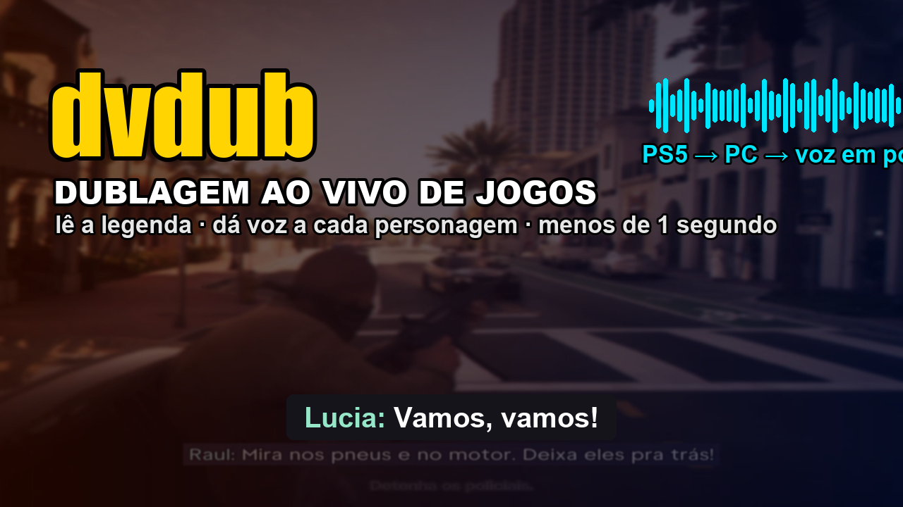
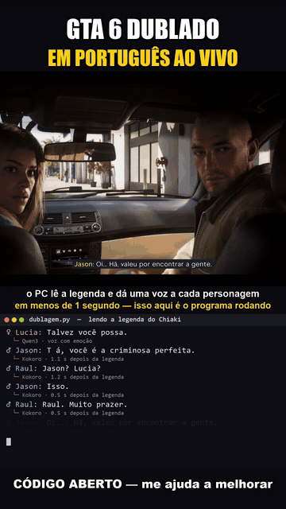

# dvdub — dublagem ao vivo



Dublagem em português, em tempo real, de jogos que já têm legenda em português: o programa **lê a
legenda na tela**, descobre quem está falando e **fala a linha com uma voz própria para cada
personagem**, cerca de 0,5 a 1 s depois de a legenda aparecer. Feito para jogar **GTA VI no PS5 pelo
PC** (Chiaki / Remote Play), mas serve para qualquer jogo em janela com legenda "Nome: fala".

Projeto pessoal, experimental, feito em um dia com ajuda de IA. Está funcionando, mas tem arestas —
por isso está aqui: **ajuda é bem-vinda** (veja "Onde ajudar").

## Demo



Vídeo completo (88 s, com o painel do programa mostrando cada fala e o atraso): [docs/demo.mp4](docs/demo.mp4).
Em cima o jogo; embaixo, o registro do `dublagem.py` com personagem, voz usada e quantos segundos depois
da legenda a fala saiu.

## Como funciona

```
tela do jogo ──► OCR do Windows (pt-BR) ──► "Lucia: Ei, que merda aconteceu?!"
                                                  │
 áudio do jogo (só o processo do Chiaki) ──► tom da voz (homem/mulher) ─┤
                                                  ▼
                                   voz por personagem ──► mixer ──► caixas de som
                                   (Kokoro, ~0,1 s)         (abaixa o jogo enquanto fala)
```

1. **Legenda**: a faixa inferior da janela do jogo é lida ~10x por segundo com o OCR nativo do
   Windows (`Windows.Media.Ocr`, 12 ms por leitura). O fundo é limpo por cor antes do OCR; várias
   leituras da mesma legenda são "votadas" para escolher a mais limpa; só o bloco centralizado que
   contém `Nome:` vale (objetivos de missão, botões de ação e o cronômetro do celular ficam de fora);
   linhas com ♪ (letra de música) são puladas.
2. **Quem fala**: tabela do elenco (`VOZ_POR_NOME`) e, para desconhecidos, o tom da voz original
   medido no áudio do jogo — capturado **só do processo do Chiaki** (process loopback do Windows,
   `captura/captura.cpp`), para a própria dublagem não voltar para a análise.
3. **Voz**: Kokoro-82M em português (0,1 s por frase), com uma voz ou mistura de vozes fixa por
   personagem (`KOKORO_POR_NOME`) e um pouco de energia pela pontuação. Opcional: servidor
   Qwen3-TTS com streaming para vozes clonadas (`servidor_qwen.py`) ou vozes com emoção por
   instrução (`servidor_custom.py`).
4. **Reprodução**: uma fala por vez, na ordem das legendas; se a fila atrasa, a fala acelera (até
   1,6x) ou é pulada; o volume do jogo baixa enquanto a voz fala.

Também há um modo que **ouve o áudio** em vez de ler a legenda (`--modo audio`: Whisper → tradução →
voz), útil para jogos sem legenda em português, porém com mais erros em gírias e nomes.

## Requisitos

- Windows 10 2004+ (process loopback de áudio e OCR nativo), pacote de idioma **Português (Brasil)**
  instalado com OCR.
- Placa NVIDIA (testado numa RTX 4070): Whisper e Kokoro rodam em CUDA.
- Python 3.11, [ffmpeg](https://ffmpeg.org) no PATH.
- O jogo numa janela do PC: Chiaki/chiaki-ng, PS Remote Play, placa de captura etc. (`PROCESSO` em
  `dublagem.py` diz qual processo tem o áudio e a janela).
- Para compilar `captura/captura.cpp`: MinGW-w64 (`g++ -O2 -static -o captura.exe captura.cpp -lole32 -luuid`).

## Instalação

```powershell
py -3.11 -m venv .venv
.\.venv\Scripts\pip install torch torchaudio --index-url https://download.pytorch.org/whl/cu124
.\.venv\Scripts\pip install -r requirements.txt
cd captura; g++ -O2 -static -o captura.exe captura.cpp -lole32 -luuid; cd ..
.\.venv\Scripts\python dublagem.py
```

Na primeira execução o Whisper (`large-v3-turbo`) e o Kokoro são baixados. Deixe o jogo em primeiro
plano; `F8` pausa, `F9` liga/desliga o abaixar do volume do jogo. O arquivo `Dublagem ao vivo.bat`
abre tudo numa janela.

### Ajustes principais (`dublagem.py`)

| Constante | O que faz |
|---|---|
| `PROCESSO` | nome do processo do jogo (`chiaki.exe`) |
| `MODO` | `legenda` (padrão) ou `audio` |
| `VOZ_POR_NOME` | elenco conhecido → voz de homem/mulher |
| `KOKORO_POR_NOME` | voz (ou mistura `a+b`) fixa por personagem |
| `CLONES`, `SCRIPT_CLONE` | personagens com voz clonada / com emoção (servidores Qwen3) |
| `FALA_VELHA`, `VELOCIDADE_MAX` | quando pular e quanto acelerar falas atrasadas |
| `legenda.FAIXA_Y` | faixa da tela onde a legenda fica (fração da altura do vídeo) |

As vozes de referência para clonagem (`vozes/`) **não** acompanham o repositório: use só vozes que
você tem direito de usar.

## Onde ajudar

- **Expressão**: as vozes rápidas (Kokoro) não têm emoção. O caminho promissor é um TTS com clone +
  streaming + instrução de emoção, estável em português (testados: Chatterbox, OmniVoice, Qwen3-TTS
  Base/CustomVoice — cada um com um problema: lentidão, instabilidade do timbre ou sotaque).
- **Falas sobrepostas**: duas pessoas falando ao mesmo tempo ainda vira uma fila.
- **OCR**: cenas muito claras sem o "fundo da legenda" do jogo ainda sujam a leitura.
- **Outros jogos / Linux**: a captura de áudio por processo e o OCR são específicos do Windows.

## Arquivos

- `dublagem.py` — programa principal (OCR → personagem → voz → mixer; modo áudio).
- `legenda.py` — leitura da legenda na tela (OCR, limpeza, blocos, ♪, cronômetro de ligação).
- `captura/captura.cpp` — captura de áudio de um processo (WASAPI process loopback).
- `servidor_qwen.py`, `servidor_custom.py` — servidores opcionais de voz (Qwen3-TTS, streaming).
- `servidor_clone.py` — servidor antigo (Chatterbox), mantido como referência.

## Licença

MIT. Os jogos, legendas e vozes citados pertencem aos seus donos; este projeto só lê a tela e o
áudio do seu próprio PC para uso pessoal.
